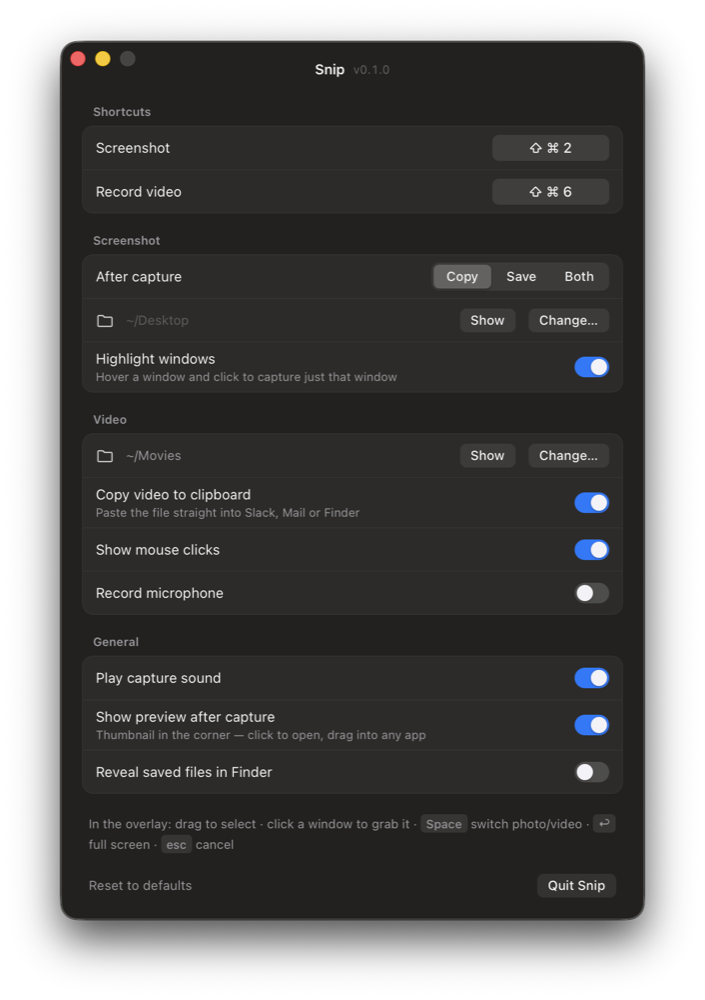

# Snip

**A tiny, instant screenshot and screen-recording tool for the macOS menu bar, written in Rust.**

Press a hotkey and drag a rectangle (or click a window): the screenshot is on your clipboard. Press the other hotkey and the same rectangle becomes a screen recording.

<p align="center">
  
</p>

| | |
|---|---|
| App size | **1.2 MB** |
| Memory at idle | **~11 MB** |
| CPU while waiting | **0%** |
| Hotkey to overlay | instant (overlay panels are pre-built) |

## Features

- **Region, window or full-screen screenshots.** Drag a region, click a highlighted window, or press ↩ for the whole screen.
- **Copy, save or both.** By default screenshots go straight to the clipboard, ready to paste with ⌘V.
- **Screen recording** of any region or window, using the macOS hardware H.264 encoder, with optional click highlighting and microphone audio.
- **Videos on the clipboard as files**, so ⌘V pastes the recording straight into Slack, Mail or Finder.
- **Preview card** after every capture: click to open, drag into any app, or jump to it in Finder.
- **Native look**: translucent overlay and preview card, a settings window that follows light and dark mode, and a menu-bar icon that adapts to your menu bar.
- **Doesn't steal focus.** The overlay takes the keyboard without pulling you out of the app you're working in.
- **Configurable**: both hotkeys, where files go, sounds, previews and more.

## Requirements

- macOS 12 or later (Apple silicon or Intel)
- [Rust](https://rustup.rs) 1.85 or later to build it

Windows support is planned; see [Roadmap](#roadmap).

## Install

```sh
git clone https://github.com/FurkanCodes/snip.git
cd snip
./bundle.sh --install
```

This builds a release `Snip.app`, copies it to `~/Applications` and launches it. Snip lives in the menu bar (a small frame with a dot), with no Dock icon.

### Screen Recording permission

macOS requires permission before any app can capture the screen.

1. Press **⌘⇧2**. Snip opens **System Settings → Privacy & Security → Screen & System Audio Recording**.
2. Turn on **Snip**, then choose **Quit & Reopen**.

Without this permission macOS only lets Snip see your wallpaper, and recordings fail.

To start Snip at login, add it under **System Settings → General → Login Items**.

## Usage

| Shortcut | Action |
|---|---|
| `⌘⇧2` | Screenshot |
| `⌘⇧6` | Record video (press again to stop) |

In the overlay:

| Input | Action |
|---|---|
| Drag | Select a region |
| Click a highlighted window | Capture just that window |
| `Space` | Switch between screenshot and video |
| `↩` | Capture the full screen |
| `Esc` or right-click | Cancel |

**Recording:** a red border marks the recorded area, with a `0:12 · Click to stop` pill just outside it. To stop, click the pill, click the menu-bar icon, or press `⌘⇧6` again. Recordings are saved as `.mov` files.

**Preview card:** after each capture a card slides in at the bottom-right showing a thumbnail, the file name and where the capture went.

- **Click** the thumbnail to open the file.
- **Drag** the thumbnail into any app to drop the file there.
- **Show in Finder** reveals the file. For screenshots that only went to the clipboard this button reads **Save** instead.
- **Copy** puts it on the clipboard again.

The card stays while you hover over it and leaves on its own a few seconds after you move away.

## Settings

Open **Settings…** from the menu-bar icon. Changes apply immediately and are saved to `~/Library/Application Support/Snip/config.json`.

| Section | Options |
|---|---|
| Shortcuts | Screenshot and record hotkeys (click one, then type the new combination) |
| Screenshot | After capture: **Copy**, **Save** or **Both**; save folder; highlight windows on hover |
| Video | Save folder; copy video file to clipboard; show mouse clicks; record microphone |
| General | Capture sound; preview card after capture; reveal saved files in Finder |

## Troubleshooting

| Problem | Fix |
|---|---|
| Screenshots show only the wallpaper, or recordings fail | Snip has no Screen Recording permission. Turn it on (see [above](#screen-recording-permission)) and reopen Snip. |
| The permission is on but captures still fail | Reset it with `tccutil reset ScreenCapture dev.snip.app`, then grant it again. |
| A hotkey does nothing | Another app may already use that shortcut. Pick a different one in Settings. |
| Anything else | Check the log at `~/Library/Logs/Snip.log`. |

## How it works

- **Overlay:** one borderless, *non-activating* `NSPanel` per display, drawn with Core Animation layers, so redrawing the selection costs almost no CPU. A non-activating panel can take the keyboard without activating the app. That matters because macOS 14+ doesn't let background apps activate themselves.
- **Screenshots:** CoreGraphics captures everything *below* the overlay window, so the overlay never has to be hidden first. The PNG is tagged with the screen's DPI, so it pastes at its on-screen size.
- **Video:** the system `screencapture -v` tool, so encoding runs on the hardware H.264 encoder. Snip stops it with `SIGINT` so the file is finalised cleanly.
- **Settings UI:** HTML in the system WebView, created only while the window is open. It costs nothing when closed.
- **Signing:** `bundle.sh` signs ad-hoc but pins the signature to the bundle ID (`dev.snip.app`), so macOS remembers the Screen Recording permission across rebuilds. Set `SIGN_ID="Apple Development: …"` to sign with a real certificate instead.

Built on [winit](https://github.com/rust-windowing/winit), [wry](https://github.com/tauri-apps/wry), [tray-icon](https://github.com/tauri-apps/tray-icon), [global-hotkey](https://github.com/tauri-apps/global-hotkey) and [objc2](https://github.com/madsmtm/objc2).

### Project layout

```
src/main.rs                     app: event loop, hotkeys, tray, selection, recording, preview, settings IPC
src/config.rs                   settings model and JSON persistence
src/icons.rs                    menu-bar icons, drawn in code
src/settings.html               settings UI
src/platform/mod.rs             portable types (Rect, Screen, overlay and preview types)
src/platform/macos.rs           overlay panel, capture, clipboard, recorder
src/platform/macos_preview.rs   post-capture preview card
src/platform/windows.rs         Windows stub with the same API
bundle.sh                       builds, signs and installs Snip.app
```

## Development

```sh
cargo run                    # run from source
cargo run -- --shot          # open the screenshot overlay right away
cargo run -- --record        # open the video overlay right away
cargo run -- --settings      # open the settings window
```

When run from source, macOS checks the Screen Recording permission of your **terminal app**, not Snip. Quit the installed Snip first so the two don't fight over the hotkeys.

Debug builds also accept `--test-shot=x,y,w,h` and `--test-record=x,y,w,h` to run the capture pipeline on a fixed region without using the mouse.

## Roadmap

- [ ] Windows backend: top-most layered overlay, DXGI capture, `CF_DIB`/`CF_HDROP` clipboard, Windows.Graphics.Capture with Media Foundation for video
- [ ] Annotations before copying (arrows, highlight, blur, text)
- [ ] GIF export
- [ ] Selections that span several displays
- [ ] Launch at login toggle
